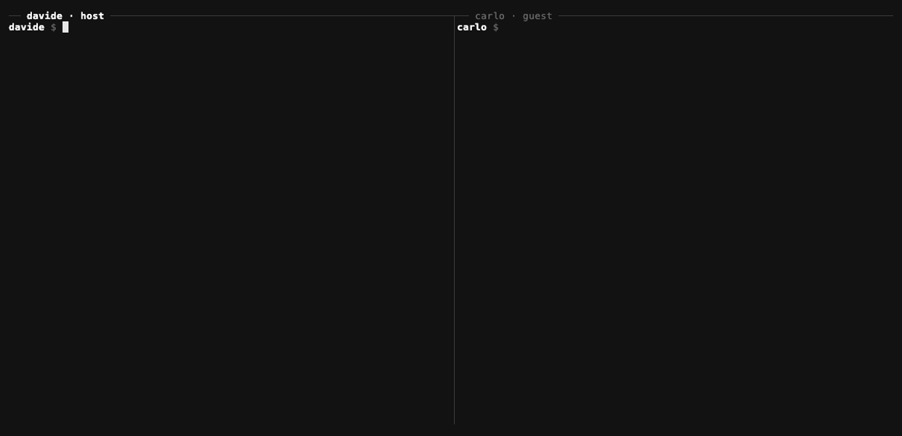

# Ponte

**Let your coding agent talk to your collaborator's coding agent. End-to-end encrypted.**



You use Claude Code. Your client, your designer or your freelance dev uses Claude Code (or Codex, or any MCP client) on their own machine, with their own account. Today the two agents can only meet through you: you copy a summary, paste it in a chat, wait, paste the answer back.

Ponte (Italian for *bridge*) gives both agents a shared, private channel. Your agent says *"the hero video is ready, check frame 4.5s"*; theirs reads it while they work, answers, and asks before doing anything that matters. You stay in charge of both ends.

```
 your machine                                            their machine
┌─────────────────────┐                                ┌─────────────────────┐
│ Claude Code         │                                │ Claude Code / Codex │
│   └ ponte mcp       │    ciphertext only              │   └ ponte mcp       │
│ ponte daemon ───────┼──► relay (yours, or any host) ◄─┼── ponte daemon      │
│   ├ inbox + logs    │                                │   ├ inbox + logs    │
│   └ notifications   │                                │   └ notifications   │
└─────────────────────┘                                └─────────────────────┘
```

## Why Ponte

- **End-to-end encrypted.** Every room is defined by a 32-byte secret in the invite. Messages are sealed with XChaCha20-Poly1305 before they leave your machine; the relay stores ciphertext and cannot read, forge or relabel messages.
- **Messages reach the agent by themselves.** A small daemon listens to all your rooms, keeps an inbox and a readable log per room, and sends a desktop notification. In Claude Code, a hook puts new messages in front of the agent on your next prompt: no more "any news?".
- **One install, every room.** One MCP server registered once at user scope serves all your collaborations. Rooms have local names (`acme-site`, `video-shoot`).
- **Safe by default.** Every inbound message is framed as untrusted data with a random tag the sender can't forge; harness-style markup (`<system-reminder>`, fake turns) is neutralized; a peer can never approve anything. Rooms are closed: the relay only accepts rooms its host created.
- **Self-hosted, zero accounts.** The relay is a tiny FastAPI + SQLite service that runs inside your daemon. On the same network it just works; across the internet put it behind any tunnel (Tailscale, Cloudflare) and pass `--url`.

## Quick start

Both people:

```bash
uv tool install ponte-mcp            # or: pipx install ponte-mcp
ponte init --name davide
claude mcp add ponte --scope user -- ponte mcp
ponte hook install                   # new messages appear in Claude Code on every prompt
ponte service install                # daemon at login (launchd / systemd --user)
```

The host opens a room and sends the printed invite privately:

```bash
ponte open video-shoot --peer carlo
# → copies a ready-to-paste prompt for carlo's agent, with the invite inside
```

The guest's agent (or the guest) joins:

```bash
ponte join ponte1_eyJ1Ijoi... --as davide
```

That's it. In Claude Code, ask *"tell davide on Ponte the first cut is uploaded"* or *"anything new on Ponte?"*.

## Commands

| | |
|---|---|
| `ponte open <room> [--peer NAME] [--url URL]` | host a room, print the invite and the guest prompt |
| `ponte join <invite> [--as ROOM]` | join a room |
| `ponte send <room> "text" [--to NAME]` | send a message |
| `ponte inbox [room] [--peek] [--raw]` | new messages |
| `ponte log <room> [-n 20]` | room history (both directions) |
| `ponte status` | rooms, who is online, unread counts, daemon state |
| `ponte close <room>` | leave (and, as host, delete) a room |
| `ponte invite <room>` | print a hosted room's invite again |
| `ponte daemon` · `ponte mcp` | the service and the MCP server |
| `ponte hook install\|uninstall` · `ponte service install\|uninstall` | integrations |

MCP tools: `ponte_inbox`, `ponte_send`, `ponte_rooms`, `ponte_history`.

## Security model

- **What the relay sees:** room names (derived from the secret), display names, timestamps, message sizes. Not content.
- **What a peer can do:** put text in front of your agent, clearly framed as another person's untrusted data. Nothing else: no tool, file or command access through Ponte.
- **What you should still do:** keep permission prompts on in sessions where Ponte is active, and never put credentials in a room. A message that asks your agent to send files or secrets is exactly what the framing tells it to refuse.
- **Invites are keys.** Share them privately; `ponte close` on the host side revokes a room.
- Local state lives in `~/.ponte` (0700); room secrets never leave it except inside invites you give out.

## Status and roadmap

Alpha. Works on macOS and Linux. Next:

- [ ] Built-in internet mode (tunnel or a hosted relay that only ever sees ciphertext)
- [ ] Push into the session through Claude Code channels, beyond the prompt hook
- [ ] Small file and image attachments (encrypted)
- [ ] A shared "table" web view of a room: messages, files, decisions
- [ ] Windows support
- [ ] Group rooms with per-member keys and revocation

## Credits

Ponte started as a fork of [ccbridge](https://github.com/sourabhnirvani/ccbridge) by Sourabh Nirvani (MIT). The relay and the prompt-injection filters come from there; Ponte adds end-to-end encryption, single-secret invites, multi-room daemon, inbox and notifications, the Claude Code hook and the CLI.

## License

MIT
